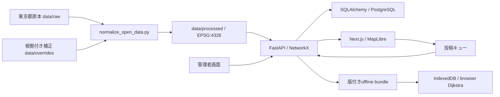

# アーキテクチャ

経路網は方向付きリンクとして読み込み、APIとブラウザで同じ重み仕様を使います。公式地点と投稿は別テーブル・別出自で保持します。DB障害時も公開データ閲覧と経路APIは可能な範囲で継続し、投稿・管理機能は停止を明示します。

フロントのMapLibreスタイルは権利不明な構内図を転載せず、公開GeoJSONから簡略図を生成します。経路線を最前面、背景ネットワークを低コントラスト、地点種別を色覚多様性対応色と記号で区別します。
